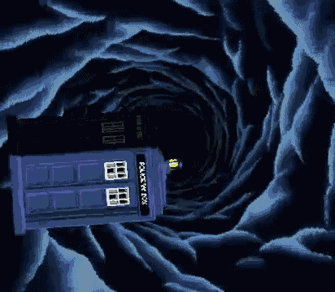

# 🌌 Multiverso News - Gallifrey Times

  

O **Multiverso News** é um portal de notícias fictício inspirado no universo de **Doctor Who**.

O projeto apresenta acontecimentos da série como se fossem notícias reais, reunidas no jornal fictício **Gallifrey Times**.

---

## 📰 Sobre o projeto

O site foi desenvolvido com o objetivo de praticar conhecimentos de desenvolvimento front-end utilizando **HTML e CSS**.

A proposta foi criar um portal jornalístico inspirado em acontecimentos, criaturas e mistérios do universo de Doctor Who.

---

## 🎨 Design e Estilo

O layout mistura elementos de um portal de notícias tradicional com uma estética de ficção científica.

* 🌌 Cores escuras com destaque em azul
* 📰 Visual inspirado em sites jornalísticos
* ✨ Efeitos de hover e animações
* 🔤 Tipografias que combinam estilos jornalísticos e tecnológicos

---

## 🛠️ Tecnologias utilizadas

O projeto foi desenvolvido utilizando **HTML e CSS puro**, sem frameworks.

---

## 📱 Responsividade

O site foi desenvolvido para se adaptar a diferentes tamanhos de tela utilizando:

* Media Queries
* CSS Grid
* Flexbox

---

## 🎯 Objetivo

Este projeto faz parte do meu aprendizado em desenvolvimento web, com foco em:

* Estruturação de páginas com HTML
* Estilização com CSS
* Responsividade
* Organização de layouts
* Criação de múltiplas páginas

---

## 🔗 Acesse o projeto

👉 https://viniciusaraujo-coder.github.io/Multiverso_News/

---

## 👨‍💻 Desenvolvido por

**Vinícius Araújo**

Projeto desenvolvido para fins de estudo e prática de desenvolvimento web.
